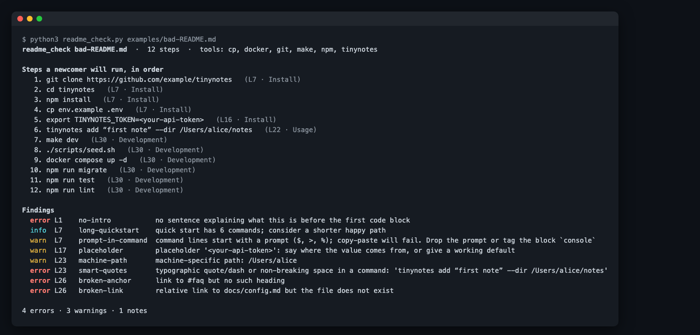

# readme-walk

**Have your coding agent follow your README like a stranger, in a clean copy, and tell you where it got stuck.**
A drop-in Skill for Claude Code (works with any agent that reads `SKILL.md`), plus a zero-dependency
static checker for the mistakes that break copy-paste.

<!-- agent-preflight -->
> **Also a Claude Code skill.** `readme-walk` is part of [agent-preflight](https://github.com/thinx-pro/agent-preflight), 16 offline checks for coding agents: `/plugin marketplace add thinx-pro/agent-preflight` then `/plugin install readme-walk@agent-preflight`, and ask Claude in plain words.

    



## Why

Terence Eden paid volunteers to follow his README while sharing their screens
([write-up](https://shkspr.mobi/blog/2026/10/i-paid-people-to-try-and-follow-my-readme/)). They hit
broken links, unclear instructions about hidden files, inconsistent quoting, and a README that never
said what the software was for. In the Hacker News discussion, a commenter described sending 20
sub-agents through their docs: the agents got stuck in the same places people did.

You can't pay testers for every release. An agent walk is cheap, repeatable, and finds the obvious
breakage before a human does. It is a complement to human testing, not a replacement: agents guess
better than people and give up later.

## Quick start

```bash
git clone https://github.com/thinx-pro/readme-walk
mkdir -p ~/.claude/skills && cp -r readme-walk/skills/readme-walk ~/.claude/skills/
```

Then, in Claude Code inside your project: **"walk the README"** (or "/readme-walk").

You get `README-FRICTION.md`: a verdict, a step-by-step table (`ok` / `guess` / `blocked` / `skip`),
the static findings and concrete README fixes. Here is a real one, from walking the README of
[port-diff](https://github.com/thinx-pro/port-diff) on the day it was published:
[examples/port-diff-walk.md](examples/port-diff-walk.md).

## What the agent is told to do

The Skill ([`skills/readme-walk/SKILL.md`](skills/readme-walk/SKILL.md)) sets hard rules:

- **Only the README.** No peeking at source, Makefiles or CI to work out what the docs meant. Needing
  them is a finding.
- **Literal execution.** Commands are run exactly as written. At most one newcomer-level fix per step,
  logged as a `guess`.
- **Clean copy.** It clones your committed tree into a scratch dir; your checkout is never touched, and
  uncommitted files can't make a broken README look fine.
- **No side effects.** No publishing, pushing, deploying, accounts, real credentials or global
  installs without asking. Steps that need a secret are logged as `blocked: needs …`.
- **Time-boxed.** About 3 minutes or 2 failed guesses per step, then it moves on.
- **Checks the promise.** If the README says "you should see X", it verifies X.

## The static checker

`readme_check.py` runs first and also works on its own (CI, pre-commit, any language project).
From the clone:

```bash
python3 skills/readme-walk/readme_check.py README.md          # human-readable, exit 1 on errors
python3 skills/readme-walk/readme_check.py README.md --json   # for scripts and agents
```

| rule | level | catches |
|---|---|---|
| `no-intro` | error | no sentence saying what the project is before the first code block |
| `smart-quotes` | error | `“ ” ‘ ’ – —` or non-breaking spaces inside commands |
| `broken-link` / `broken-anchor` | error | relative links to missing files, `#anchors` with no matching heading |
| `prompt-in-command` | warn | `$ ` / `> ` / `% ` prompts that break copy-paste (blocks tagged `console` are exempt; output lines are skipped) |
| `placeholder` | warn | `<your-token>`, `YOUR_API_KEY`, `xxx`, `changeme` with no hint where the value comes from |
| `missing-tool` | warn | the commands use a tool that isn't installed on this machine (a prerequisite you didn't list?) |
| `machine-path` | warn | `/Users/alice`, `/home/bob`, `C:\Users\…` |
| `pipe-to-shell` | info | `curl … \| sh` without a way to inspect it |
| `long-quickstart` | info | more than 5 commands under Install / Quick start / Usage |

It also prints every runnable step in order, which is the script the agent walks. Python 3.9+, stdlib only.

## Limitations and roadmap

- The walk runs on your machine, so tools you already have installed hide missing prerequisites.
  `missing-tool` helps; a container mode (`--docker ubuntu:24.04`) is on the roadmap.
- An agent is not a beginner. It knows common tooling and guesses well, so a clean walk does not prove
  the README is clear to humans. A failed walk is strong evidence it isn't.
- Steps that need accounts, paid APIs or secrets are reported as blocked, not tested.
- The checker is heuristic Markdown parsing (fenced blocks, headings, links), not a full CommonMark parser.
- Planned: a non-interactive CI recipe (`claude -p` in a fresh container), Windows/PowerShell step
  extraction, and a `--fix` mode that proposes README patches for the static findings.

## Development

```bash
python3 -m unittest discover -s tests
python3 scripts/render_demo.py      # regenerates assets/check.html for the screenshot
```

## License

MIT
